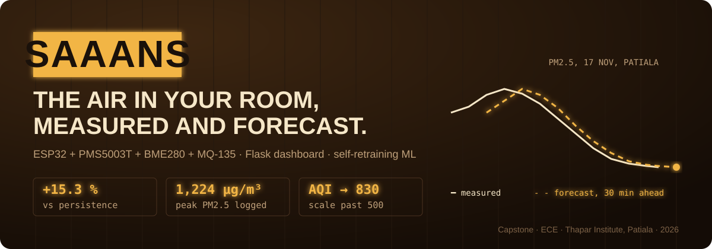
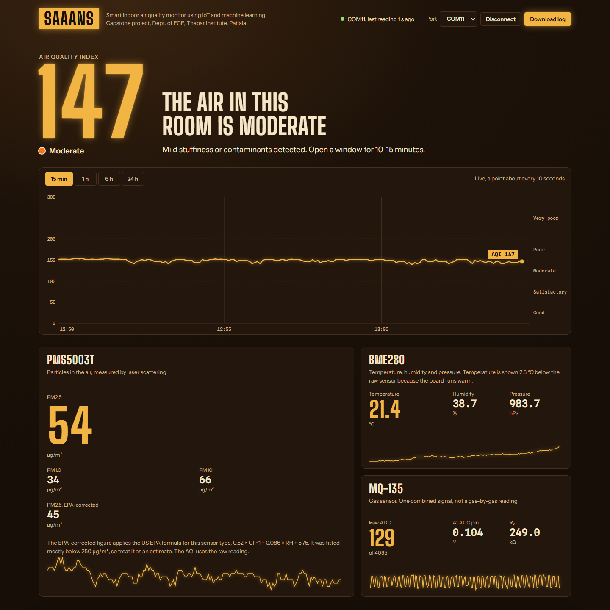
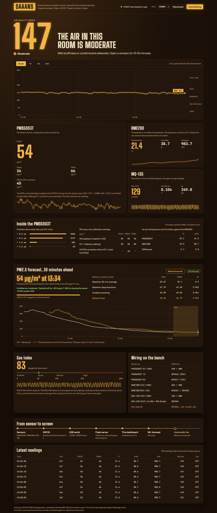
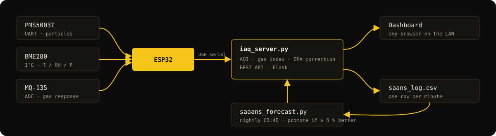

<p align="center">
  
</p>

<p align="center">
  
  
  
  
  
</p>

<p align="center">
  <b>An indoor air quality monitor using IoT and machine learning.</b><br>
  Three sensors on an ESP32, a live web dashboard, an AQI that keeps counting past 500,<br>
  and a 30 minute PM2.5 forecast that is shown only when it beats a naive baseline.
</p>

<p align="center">
  Capstone project · Department of ECE · Thapar Institute of Engineering and Technology, Patiala · 2026
</p>

<p align="center">
  <a href="#the-problem">Problem</a> ·
  <a href="#results">Results</a> ·
  <a href="#hardware">Hardware</a> ·
  <a href="#how-it-works">How it works</a> ·
  <a href="#limits">Limits</a> ·
  <a href="#run-it">Run it</a>
</p>

<br>



<p align="center"><sub>The live dashboard on 17 Nov 2026 in Patiala. Every number on screen is a real reading from the hardware.</sub></p>

<br>

<a id="the-problem"></a>


The AQI most people check comes from outdoor government stations, often kilometres away. Indoor air behaves differently: cooking, incense, closed windows at night and festival smoke can push a room far above or below the outdoor figure. During development, Diwali night in Delhi drove this sensor past **1,224 µg/m³ of PM2.5**, a level where the standard AQI scale simply stops at 500.

Low cost sensors make indoor monitoring affordable, but they drift, over-read in humid air, and gas sensors like the MQ-135 cannot tell one gas from another. SAAANS is built around that reality: measure the room continuously, be honest about uncertainty, and give enough warning to act.

**Objectives**

1. Measure PM1.0, PM2.5, PM10, temperature, humidity, pressure and a combined gas level, continuously and cheaply.
2. Show it on a dashboard a non-technical person can read at a glance.
3. Compute AQI correctly, including above the official scale.
4. Forecast PM2.5 30 minutes ahead with a model that retrains itself and is held to a measurable standard.
5. Compare the sensor with public stations and document the differences.
6. Run unattended for days, recovering from crashes, sleep and power cuts.

| Feature | What it does |
|---|---|
| **Live dashboard** | AQI, PM1.0/2.5/10, particle counts by size, temperature, humidity, pressure, gas index, history charts and forecast, refreshed about every 10 s |
| **AQI past 500** | US EPA PM2.5 breakpoints, extended above 500.4 µg/m³ at the slope of the top band, so 1,000 µg/m³ reads about 830 |
| **EPA-corrected PM2.5** | The US EPA correction for Plantower sensors, shown next to the raw value |
| **Gas index** | MQ-135 as a room-relative index (100 = this room's usual air) instead of invented per-gas ppm |
| **Warm-up awareness** | Detects power cuts from gaps in the log and greys out the gas index for two hours while the heater settles |
| **ML forecast** | PM2.5 30 minutes ahead, retrained nightly, promoted only if it beats persistence by 5 % or more |
| **Forecast vs reality** | Past forecasts drawn against what actually happened |
| **Reference checks** | Side-by-side records against a public monitoring station |
| **Self-healing** | Task Scheduler watchdog restarts the server within five minutes |
| **CSV export** | One row per minute, downloadable from the dashboard |

<br>

<a id="results"></a>


Evaluated on about 200 hours of logged data. The test set is the most recent 2,143 minutes, kept out of training and model selection, with PM2.5 between 148 and 1,224 µg/m³.

| Model | MAE (µg/m³) | RMSE | R² |
|---|---:|---:|---:|
| **Robust linear (Huber), promoted** | **40.5** | **56.8** | **0.951** |
| Gradient boosting (absolute error loss) | 43.3 | 62.0 | 0.941 |
| Baseline: stays the same | 47.8 | 61.7 | 0.942 |
| Baseline: 30 minute average | 63.4 | 81.1 | 0.900 |

> [!NOTE]
> The promoted model is **15.3 % better** than "the level stays the same", above the 5 % bar it must clear to go live. It has been retrained every night since 6 Nov 2026; every run is in [`saaans_output/retrain_log.csv`](saaans_output/retrain_log.csv).

<details>
<summary><b>Full dashboard, including the forecast panel</b></summary>
<br>



The yellow dashed forecast tracks the white measured line through a fall from about 350 to 60 µg/m³.
</details>

**What the data showed**

- **Festival smoke is extreme.** Diwali night in Delhi produced indoor PM2.5 above 1,200 µg/m³, which is why the AQI scale had to be extended.
- **Indoor and outdoor differ a lot.** Across 20 reference checks the sensor to station ratio ranged from 0.3 to 3.4. High ratios cluster at night with the room closed.
- **Tree models could not extrapolate.** Early models that predicted the PM2.5 level collapsed during Diwali (forecasting 327 while the room was at 630) because they had never seen such values. Predicting the *change* over 30 minutes fixed it.

All results come from the real sensor log. Nothing is simulated or tuned to match a reference.

<br>

<a id="hardware"></a>


| Part | Measures | ESP32 connection |
|---|---|---|
| ESP32 DevKit | Reads sensors, sends one line over USB serial | |
| Plantower **PMS5003T** | PM1.0 / 2.5 / 10, particle counts 0.3 to 10 µm, own temperature and humidity | UART2: sensor TX → GPIO16, sensor RX → GPIO17, 5 V |
| Bosch **BME280** | Temperature, humidity, pressure | I²C: SDA GPIO21, SCL GPIO22, 3.3 V |
| Winsen **MQ-135** | Combined response to VOCs, smoke, NH₃, alcohol | AOUT → GPIO34 via 18 kΩ / 33 kΩ divider, 5 V heater |
| Relay and fan *(planned)* | Automatic ventilation | GPIO26 |

**Notes from the bench**

- The MQ-135 output can reach 5 V while ESP32 pins tolerate 3.3 V. The divider scales it down; the server undoes the scaling before computing sensor resistance.
- The BME280 sits near the warm ESP32, so the dashboard shows its temperature 2.5 °C lower and lists the PMS5003T's own thermometer alongside for comparison.
- The MQ-135 clean-air resistance R0 (249 kΩ) is stored in `calibration.json` and can be re-measured from the dashboard.

<br>

<a id="how-it-works"></a>




The ESP32 only reads sensors. All calculation happens in Python on the PC, so the analysis can change without reflashing.

**AQI.** US EPA PM2.5 breakpoints from 0 to 500.4 µg/m³ with linear interpolation inside each band. Above 500.4 the top band's slope (99 AQI points per 149.9 µg/m³) continues up to 1,000 µg/m³. Readings between two bands take the upper band, so AQI never under-reports.

**EPA correction.** Plantower sensors over-read in humid air because particles take up water and look larger. The US EPA nationwide correction (Barkjohn et al., 2021) is shown for reference:

```text
PM2.5 corrected = 0.52 × PM2.5(CF=1) − 0.086 × RH + 5.75
```

The AQI keeps using the raw reading so historical results stay comparable.

**Gas index.** The MQ-135's resistance Rs falls as gas rises. Since the sensor cannot separate gases, SAAANS reports `100 × R0 / Rs`: below 80 cleaner than usual, 80 to 150 usual, 150 to 250 raised, 250 and up high. The sensor physics is in [MQ135_GAS_ESTIMATION_METHODOLOGY.md](MQ135_GAS_ESTIMATION_METHODOLOGY.md).

**Forecast.**

| Step | Choice | Reason |
|---|---|---|
| Target | Change in PM2.5 over the next 30 minutes | Handles levels the model has never seen |
| Features | Momentum over 1, 2, 5, 10 min; deviation from 15, 30, 60 min means; 15 min volatility; change in 0.3 µm count; humidity trend; time of day (sin, cos); current level | Describe movement, which carries across days and places |
| Candidates | Huber linear regression; gradient boosting with absolute error loss | Both resist the sudden spikes common indoors |
| Shrink | 0.5 linear, 0.75 boosting | Pulling towards "no change" cut validation error |
| Selection | Validation split from the training period only | The test set is never seen before final scoring |
| Promotion | Replace the live model only if ≥ 5 % better than persistence | A worse model can never go live silently |
| History needed | 60 continuous minutes | Stays blank after a power cut rather than guessing |
| Retraining | Nightly at 03:40 | Adapts as new data arrives |

Persistence is the baseline because air usually changes slowly, so "it will stay the same" is a strong forecast. Beating it is the real test of whether a model adds anything.

**Validation.** `add_reference.py` takes a public station's PM2.5 and PM10, averages the sensor's previous 60 minutes (at least 30 readings), and appends both with the ratio, temperature and humidity to [`reference_checks.csv`](reference_checks.csv). Twenty checks have been recorded so far in Delhi and Patiala, across day and night.

<br>

<a id="limits"></a>


- **Indoor vs outdoor.** Reference stations measure outdoor air, so they bound the sensor's behaviour but cannot calibrate it. No single correction factor fits the 0.3 to 3.4 range seen.
- **Very high levels.** The EPA correction was fitted mostly below about 250 µg/m³; at festival-smoke levels it is an estimate.
- **MQ-135 selectivity.** It cannot identify gases and responds to temperature and humidity. The gas index is relative, not absolute.
- **One room.** The forecast describes the room it was trained in and would need retraining elsewhere.
- **PC dependency.** Logging stops if the PC sleeps; the watchdog restarts the server on wake.

<br>

<a id="run-it"></a>


**1. Flash the firmware** (replace `COM11` with your port)

```bash
arduino-cli core install esp32:esp32
arduino-cli lib install "Adafruit BME280 Library"
arduino-cli compile --fqbn esp32:esp32:esp32 ESP32_SAANS
arduino-cli upload  --fqbn esp32:esp32:esp32 -p COM11 ESP32_SAANS
```

**2. Start the server**

```bash
pip install -r requirements.txt
python iaq_server.py
```

Open **http://localhost:5000** and pick the serial port if it is not found automatically. With no ESP32 connected the server falls back to simulated data; set `SAANS_SIM=0` to turn that off.

**3. Train the forecast.** The server trains on its own once enough data exists (about 3 hours to begin, 72 hours for a reliable result). To retrain by hand:

```bash
python saaans_forecast.py
```

**4. Keep it running on Windows.** Create two Task Scheduler tasks: one runs `start_saaans.ps1` at log-on and every 5 minutes (it exits at once if the server is already up), the other runs `python saaans_forecast.py` daily at 03:40.

**5. Record a reference check**

```bash
python add_reference.py 145 210 --source "Station name"
```

<details>
<summary><b>REST API</b></summary>

| Endpoint | Description |
|---|---|
| `GET /api/data` | Latest reading with AQI, gas index and EPA-corrected PM2.5 |
| `GET /api/status` | Serial connection, last reading, MQ-135 warm-up minutes |
| `GET /api/history`, `GET /api/trend` | Recent series for the charts |
| `GET /api/forecast` | 30 minute forecast, confidence, model metrics |
| `GET /api/forecast/series` | Past forecasts against what happened |
| `POST /api/forecast/retrain` | Retrain now (promotion rule still applies) |
| `POST /api/calibrate` | Re-measure MQ-135 R0 in clean air |
| `GET /api/ports`, `POST /api/connect` | List and choose the serial port |
| `GET /api/export` | Download the log as CSV |
</details>

<details>
<summary><b>Repository layout</b></summary>

```text
iaq_server.py              Flask server: serial reader, AQI, gas index, EPA correction, API
saaans_forecast.py         Features, training, champion and challenger promotion
add_reference.py           Record a comparison with a public station
start_saaans.ps1 / .bat    Start-up script used by the watchdog
capture_serial_data.py     Stand-alone serial to CSV capture
saaans_ml.py, saaans_live.py, saaans_demo.py, saaans_simple.py
                           Earlier analysis and command line tools
templates/, static/        Dashboard (plain HTML, CSS, JS; no build step)
ESP32_SAANS/               Production firmware
ESP32_DataLogger/, ESP32_Live_Monitor/, MQ135_IAQ_Monitor/, BME280*/
                           Bring-up and test sketches
saaans_output/             Current model, metrics, retrain history, sample data
docs/                      Screenshots and README artwork
calibration.json           MQ-135 R0
reference_checks.csv       Sensor vs public station comparisons
```
</details>

**Roadmap**

- [x] Live dashboard, extended AQI, gas index, EPA correction
- [x] Self-retraining forecast with a promotion gate
- [x] Watchdog auto-restart and nightly retrain
- [ ] Relay-controlled ventilation fan with a dashboard switch
- [ ] LSTM forecaster compared against the current model
- [ ] Alerts when AQI crosses a threshold
- [ ] Phone access over Wi-Fi

**References**

1. US EPA, *Technical Assistance Document for the Reporting of Daily Air Quality (AQI)*.
2. K. K. Barkjohn, B. Gantt, A. L. Clements, "Development and application of a United States-wide correction for PM2.5 data collected with the PurpleAir sensor", *Atmospheric Measurement Techniques*, 2021.
3. Plantower PMS5003T, Bosch BME280 and Winsen MQ-135 datasheets.
4. P. J. Huber, "Robust Estimation of a Location Parameter", *Annals of Mathematical Statistics*, 1964.

<br>

<p align="center"><sub>Licensed under GPL-3.0. See <a href="LICENSE.txt">LICENSE.txt</a>.</sub></p>
